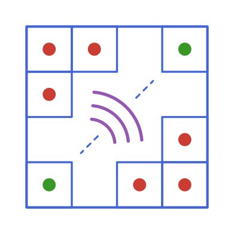

# MLFMA

  

A Julia package for fast matrix-vector products with wave-kernel matrices using
the multilevel fast multipole algorithm (MLFMA). Built-in assemblers work with
integral operators and function spaces from [BEAST.jl](https://github.com/krcools/BEAST.jl),
for example for boundary element discretizations of Helmholtz and Maxwell equations.

The package provides angular sampling, far-field representations, transfers between
tree levels, and diagonal translations between well-separated clusters.
[H2Trees.jl](https://github.com/djukic14/H2Trees.jl) organizes the geometry;
[H2Factory.jl](https://github.com/djukic14/H2Factory.jl) handles tree passes and workspaces.

**Development status:** Parts of the code are still experimental. APIs and defaults
may change, and not all combinations of operators, representations, and sampling
strategies have been validated. The package is not yet registered.

## Documentation

The [development docs](https://djukic14.github.io/MLFMA.jl/dev/) cover construction,
sampling, far-field storage, and translations, with interactive figures.

For a related approach using polynomial interpolation, see
[MultilevelKernelInterpolation.jl](https://github.com/djukic14/MultilevelKernelInterpolation.jl).
Both packages build on H2Trees and H2Factory.
